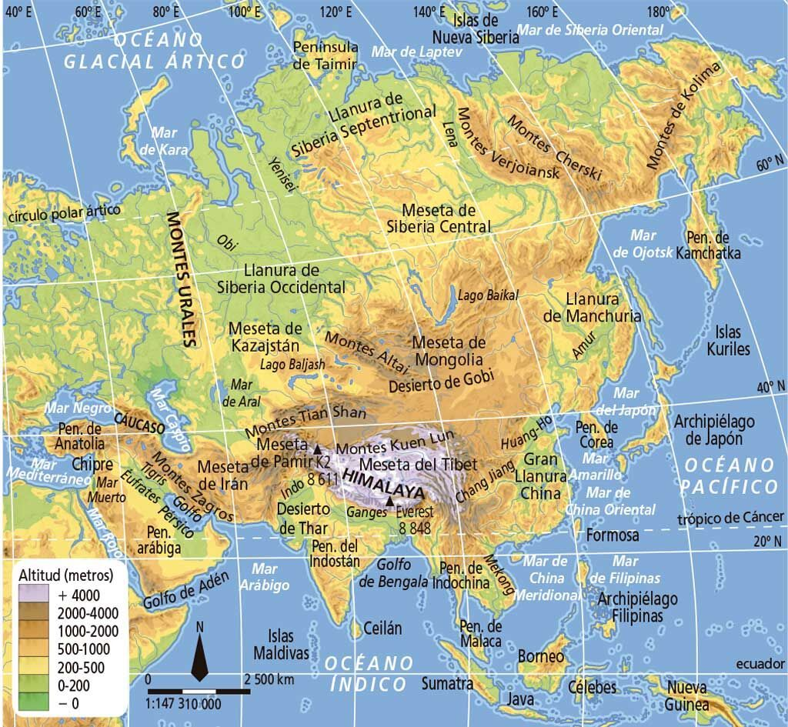
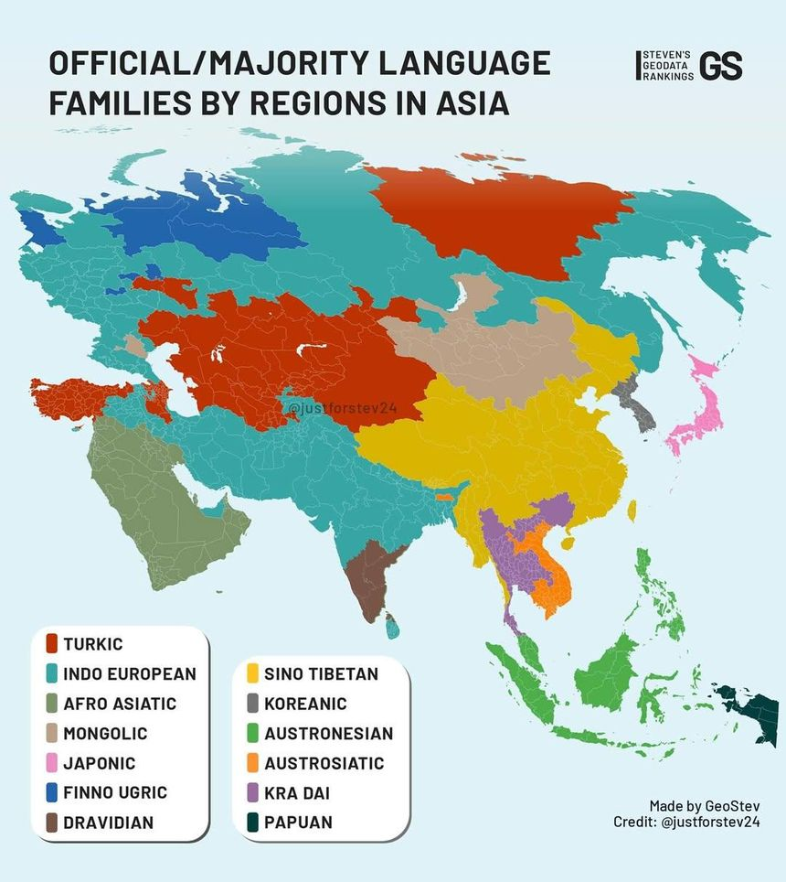
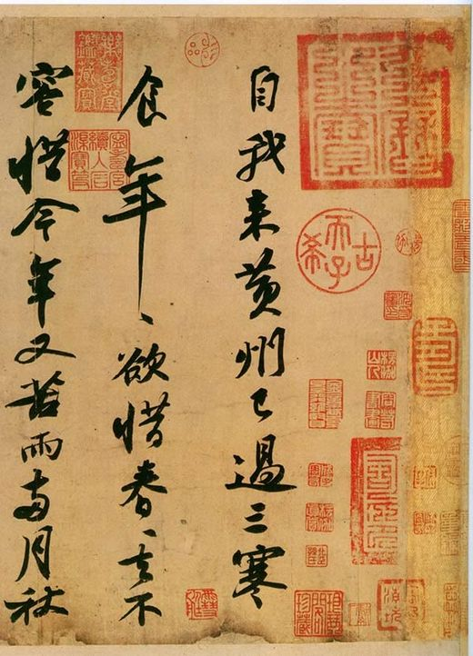
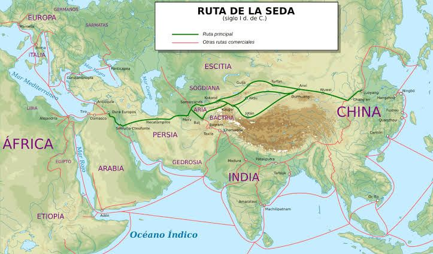
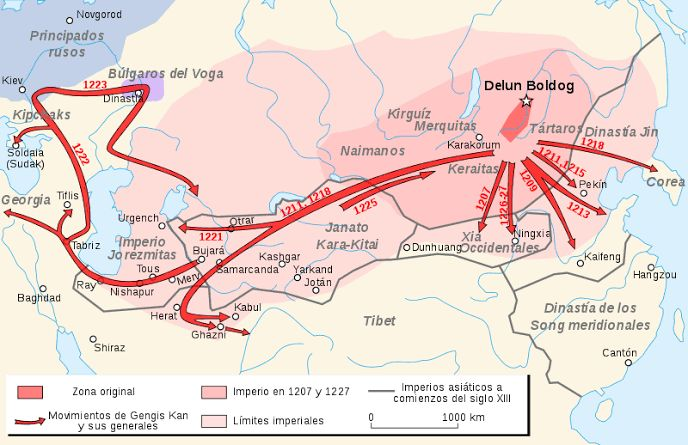
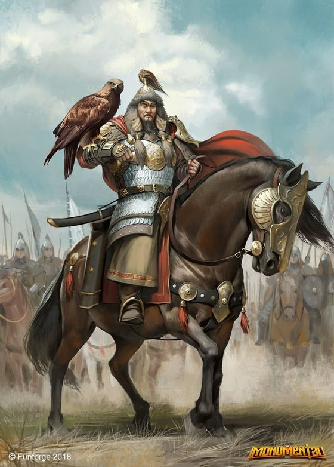
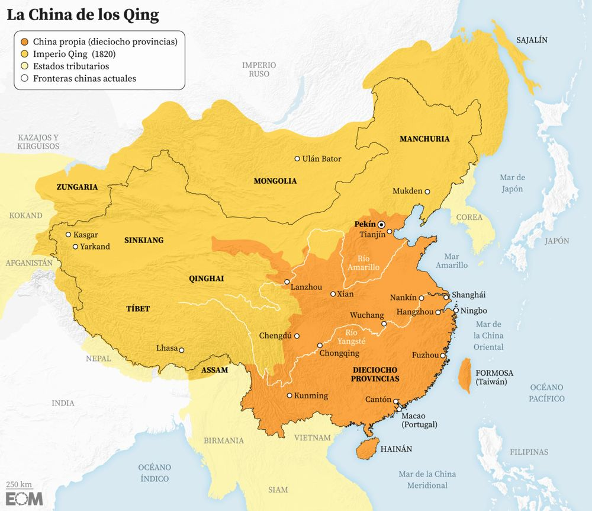
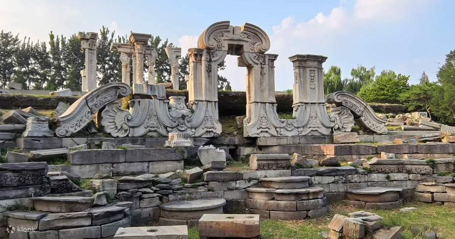
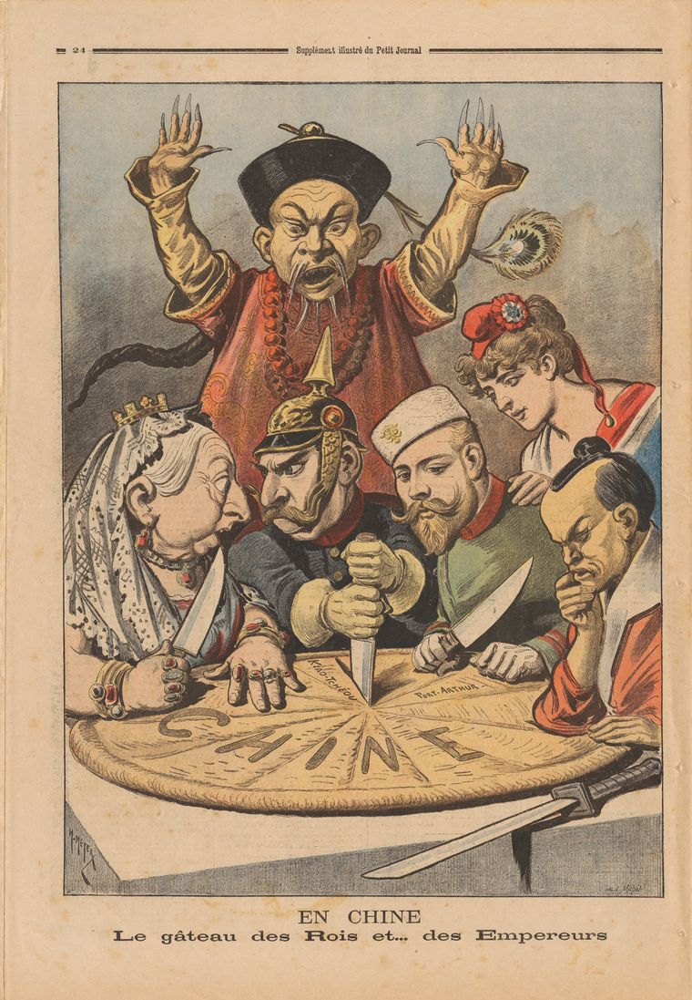
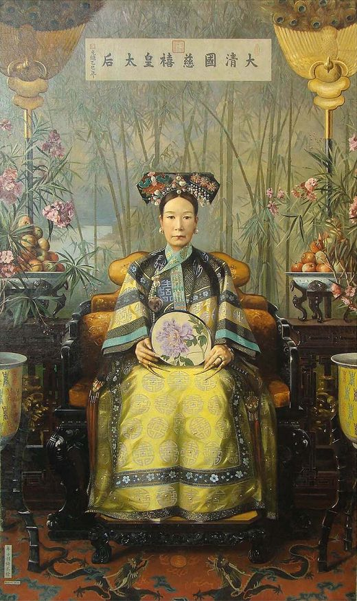

<!doctype html>
<html lang="ca">
<head>
<meta charset="utf-8">
<meta name="viewport" content="width=device-width, initial-scale=1, viewport-fit=cover">
<meta name="description" content="Apunts del curs de cultura asiàtica de la professora Elvira Sánchez, recollits per Immaculada Pellicer.">
<link rel="icon" href="data:image/svg+xml,%3Csvg xmlns='http://www.w3.org/2000/svg' viewBox='0 0 32 32'%3E%3Ccircle cx='16' cy='16' r='13' fill='%23d9372b'/%3E%3C/svg%3E">

<title>Quadern d'Àsia</title>
<link rel="preconnect" href="https://fonts.googleapis.com">
<link rel="stylesheet" href="https://fonts.googleapis.com/css2?family=Anton&family=Cormorant+Garamond:ital,wght@1,500;1,600&family=Zen+Kaku+Gothic+New:wght@400;500;700&family=Zen+Old+Mincho:wght@600;900&family=DM+Mono:wght@400;500&display=swap">

</head>
<body>

<header class="cover">
  

    
[ Cultura asiàtica ]Curs 202612 classes

    
<svg viewBox="-30 -4 660 133"><defs><clipPath id='cc'><rect x='-30' y='-10' width='660' height='139'/></clipPath></defs><g clip-path='url(#cc)'><circle cx='180' cy='46' r='46'/><circle cx='180' cy='46' r='38.4'/><circle cx='180' cy='46' r='30.8'/><circle cx='180' cy='46' r='23.2'/><circle cx='180' cy='46' r='15.6'/><circle cx='180' cy='46' r='8'/><circle cx='260' cy='46' r='46'/><circle cx='260' cy='46' r='38.4'/><circle cx='260' cy='46' r='30.8'/><circle cx='260' cy='46' r='23.2'/><circle cx='260' cy='46' r='15.6'/><circle cx='260' cy='46' r='8'/><circle cx='340' cy='46' r='46'/><circle cx='340' cy='46' r='38.4'/><circle cx='340' cy='46' r='30.8'/><circle cx='340' cy='46' r='23.2'/><circle cx='340' cy='46' r='15.6'/><circle cx='340' cy='46' r='8'/><circle cx='100' cy='73' r='46'/><circle cx='100' cy='73' r='38.4'/><circle cx='100' cy='73' r='30.8'/><circle cx='100' cy='73' r='23.2'/><circle cx='100' cy='73' r='15.6'/><circle cx='100' cy='73' r='8'/><circle cx='180' cy='73' r='46'/><circle cx='180' cy='73' r='38.4'/><circle cx='180' cy='73' r='30.8'/><circle cx='180' cy='73' r='23.2'/><circle cx='180' cy='73' r='15.6'/><circle cx='180' cy='73' r='8'/><circle cx='260' cy='73' r='46'/><circle cx='260' cy='73' r='38.4'/><circle cx='260' cy='73' r='30.8'/><circle cx='260' cy='73' r='23.2'/><circle cx='260' cy='73' r='15.6'/><circle cx='260' cy='73' r='8'/><circle cx='340' cy='73' r='46'/><circle cx='340' cy='73' r='38.4'/><circle cx='340' cy='73' r='30.8'/><circle cx='340' cy='73' r='23.2'/><circle cx='340' cy='73' r='15.6'/><circle cx='340' cy='73' r='8'/><circle cx='420' cy='73' r='46'/><circle cx='420' cy='73' r='38.4'/><circle cx='420' cy='73' r='30.8'/><circle cx='420' cy='73' r='23.2'/><circle cx='420' cy='73' r='15.6'/><circle cx='420' cy='73' r='8'/><circle cx='60' cy='100' r='46'/><circle cx='60' cy='100' r='38.4'/><circle cx='60' cy='100' r='30.8'/><circle cx='60' cy='100' r='23.2'/><circle cx='60' cy='100' r='15.6'/><circle cx='60' cy='100' r='8'/><circle cx='140' cy='100' r='46'/><circle cx='140' cy='100' r='38.4'/><circle cx='140' cy='100' r='30.8'/><circle cx='140' cy='100' r='23.2'/><circle cx='140' cy='100' r='15.6'/><circle cx='140' cy='100' r='8'/><circle cx='220' cy='100' r='46'/><circle cx='220' cy='100' r='38.4'/><circle cx='220' cy='100' r='30.8'/><circle cx='220' cy='100' r='23.2'/><circle cx='220' cy='100' r='15.6'/><circle cx='220' cy='100' r='8'/><circle cx='300' cy='100' r='46'/><circle cx='300' cy='100' r='38.4'/><circle cx='300' cy='100' r='30.8'/><circle cx='300' cy='100' r='23.2'/><circle cx='300' cy='100' r='15.6'/><circle cx='300' cy='100' r='8'/><circle cx='380' cy='100' r='46'/><circle cx='380' cy='100' r='38.4'/><circle cx='380' cy='100' r='30.8'/><circle cx='380' cy='100' r='23.2'/><circle cx='380' cy='100' r='15.6'/><circle cx='380' cy='100' r='8'/><circle cx='460' cy='100' r='46'/><circle cx='460' cy='100' r='38.4'/><circle cx='460' cy='100' r='30.8'/><circle cx='460' cy='100' r='23.2'/><circle cx='460' cy='100' r='15.6'/><circle cx='460' cy='100' r='8'/><circle cx='540' cy='100' r='46'/><circle cx='540' cy='100' r='38.4'/><circle cx='540' cy='100' r='30.8'/><circle cx='540' cy='100' r='23.2'/><circle cx='540' cy='100' r='15.6'/><circle cx='540' cy='100' r='8'/><circle cx='20' cy='127' r='46'/><circle cx='20' cy='127' r='38.4'/><circle cx='20' cy='127' r='30.8'/><circle cx='20' cy='127' r='23.2'/><circle cx='20' cy='127' r='15.6'/><circle cx='20' cy='127' r='8'/><circle cx='100' cy='127' r='46'/><circle cx='100' cy='127' r='38.4'/><circle cx='100' cy='127' r='30.8'/><circle cx='100' cy='127' r='23.2'/><circle cx='100' cy='127' r='15.6'/><circle cx='100' cy='127' r='8'/><circle cx='180' cy='127' r='46'/><circle cx='180' cy='127' r='38.4'/><circle cx='180' cy='127' r='30.8'/><circle cx='180' cy='127' r='23.2'/><circle cx='180' cy='127' r='15.6'/><circle cx='180' cy='127' r='8'/><circle cx='260' cy='127' r='46'/><circle cx='260' cy='127' r='38.4'/><circle cx='260' cy='127' r='30.8'/><circle cx='260' cy='127' r='23.2'/><circle cx='260' cy='127' r='15.6'/><circle cx='260' cy='127' r='8'/><circle cx='340' cy='127' r='46'/><circle cx='340' cy='127' r='38.4'/><circle cx='340' cy='127' r='30.8'/><circle cx='340' cy='127' r='23.2'/><circle cx='340' cy='127' r='15.6'/><circle cx='340' cy='127' r='8'/><circle cx='420' cy='127' r='46'/><circle cx='420' cy='127' r='38.4'/><circle cx='420' cy='127' r='30.8'/><circle cx='420' cy='127' r='23.2'/><circle cx='420' cy='127' r='15.6'/><circle cx='420' cy='127' r='8'/><circle cx='500' cy='127' r='46'/><circle cx='500' cy='127' r='38.4'/><circle cx='500' cy='127' r='30.8'/><circle cx='500' cy='127' r='23.2'/><circle cx='500' cy='127' r='15.6'/><circle cx='500' cy='127' r='8'/><circle cx='580' cy='127' r='46'/><circle cx='580' cy='127' r='38.4'/><circle cx='580' cy='127' r='30.8'/><circle cx='580' cy='127' r='23.2'/><circle cx='580' cy='127' r='15.6'/><circle cx='580' cy='127' r='8'/></g></svg>

    

      <h1 class="strip main" lang="ja" aria-label="Quadern d'Àsia · 亜細亜の文化">亜細亜の文化</h1>
      
Quadern d'Àsia

      
講座 Prof. Elvira Sánchez · Apunts d'Immaculada Pellicer

    

    

    

      Quadern d'Àsia
      <a href="#index">↓ Escollir classe</a>
    

  

</header>

<section class="idx" id="index">
  

    
PintorescaMil·lenàriaDiversa

    

    
<i class="w"></i><i class="r"></i><i class="k"></i>

    <h2 class="idx-title">Índex<em>de classes</em></h2>
    

      [ Prof. Elvira Sánchez · apunts d'Immaculada Pellicer ]
      
Escull una classe per obrir-ne els apunts. Les classes noves s'aniran afegint aquí a mesura que avanci el curs.

    

    <ol class="classes">
      <li><a href="#classe-01">01Generalitats14.09.2026Obrir apunts →</a></li>
      <li><a href="#classe-02">02La Xina I: declivi de l'imperi manxú i República21.09.2026Obrir apunts →</a></li>
      <li>
03La Xina IIPendent
</li>
      <li>
04Per escriurePendent
</li><li>
05Per escriurePendent
</li><li>
06Per escriurePendent
</li><li>
07Per escriurePendent
</li><li>
08Per escriurePendent
</li><li>
09Per escriurePendent
</li><li>
10Per escriurePendent
</li><li>
11Per escriurePendent
</li><li>
12Per escriurePendent
</li>
    </ol>
    
/Japó/Índia/Xina/Iran/Els -stan/Vietnam/Indonèsia/Corea/Tailàndia/Birmània

  

</section>

<a class="back" href="#index">← Índex</a>

[ Classe 01 ]Generalitats14.09.2026

<header class="hero">
  

    

      

      
14.09.2026

      
Curs de cultura asiàtica Prof. Elvira Sánchez Apunts d'Immaculada Pellicer Classe 01 de 12

      
亜細亜ÀSIA CLASSE 01

      

    

    

      <svg class="net" data-speed="-0.12" viewBox="0 0 300 300" aria-hidden="true"><path d='M0 0 L2.34 10 L4.52 20 L6.39 30 L7.82 40 L8.71 50 L9 60 L8.67 70 L7.74 80 L6.29 90 L4.39 100 L2.2 110 L-0.15 120 L-2.48 130 L-4.65 140 L-6.49 150 L-7.89 160 L-8.74 170 L-9 180 L-8.63 190 L-7.67 200 L-6.18 210 L-4.27 220 L-2.06 230 L0.29 240 L2.62 250 L4.77 260 L6.59 270 L7.96 280 L8.78 290 L8.99 300 M30 0 L32.12 10.22 L34.1 20.45 L35.79 30.67 L37.09 40.89 L37.89 51.11 L38.16 61.34 L37.86 71.56 L37.02 81.78 L35.7 92 L33.98 102.23 L31.99 112.45 L29.87 122.67 L27.75 132.89 L25.79 143.12 L24.12 153.34 L22.85 163.56 L22.08 173.78 L21.85 184.01 L22.18 194.23 L23.05 204.45 L24.4 214.67 L26.13 224.9 L28.14 235.12 L30.27 245.34 L32.38 255.56 L34.33 265.79 L35.97 276.01 L37.21 286.23 L37.96 296.45 L38.15 306.68 M60 0 L61.9 10.35 L63.67 20.71 L65.19 31.06 L66.35 41.41 L67.08 51.77 L67.31 62.12 L67.05 72.48 L66.29 82.83 L65.11 93.18 L63.57 103.54 L61.79 113.89 L59.88 124.24 L57.98 134.6 L56.22 144.95 L54.72 155.31 L53.59 165.66 L52.89 176.01 L52.69 186.37 L52.99 196.72 L53.77 207.07 L54.98 217.43 L56.53 227.78 L58.33 238.14 L60.24 248.49 L62.13 258.84 L63.88 269.2 L65.36 279.55 L66.47 289.9 L67.13 300.26 L67.31 310.61 M90 0 L91.68 10.34 L93.25 20.68 L94.59 31.02 L95.62 41.36 L96.26 51.7 L96.47 62.04 L96.23 72.38 L95.57 82.72 L94.52 93.06 L93.16 103.4 L91.58 113.74 L89.89 124.08 L88.22 134.42 L86.66 144.76 L85.33 155.1 L84.33 165.44 L83.71 175.78 L83.53 186.12 L83.8 196.45 L84.49 206.79 L85.56 217.13 L86.93 227.47 L88.52 237.81 L90.21 248.15 L91.89 258.49 L93.43 268.83 L94.74 279.17 L95.72 289.51 L96.31 299.85 L96.46 310.19 M120 0 L121.46 10.19 L122.83 20.37 L123.99 30.56 L124.89 40.75 L125.44 50.93 L125.62 61.12 L125.42 71.3 L124.84 81.49 L123.93 91.68 L122.75 101.86 L121.37 112.05 L119.91 122.24 L118.45 132.42 L117.1 142.61 L115.94 152.79 L115.07 162.98 L114.53 173.17 L114.38 183.35 L114.61 193.54 L115.21 203.73 L116.14 213.91 L117.33 224.1 L118.71 234.28 L120.18 244.47 L121.64 254.66 L122.98 264.84 L124.12 275.03 L124.97 285.22 L125.49 295.4 L125.62 305.59 M150 0 L151.24 9.96 L152.4 19.91 L153.39 29.87 L154.15 39.83 L154.63 49.78 L154.78 59.74 L154.61 69.69 L154.11 79.65 L153.34 89.61 L152.33 99.56 L151.17 109.52 L149.92 119.48 L148.68 129.43 L147.53 139.39 L146.55 149.35 L145.81 159.3 L145.35 169.26 L145.22 179.21 L145.42 189.17 L145.93 199.13 L146.72 209.08 L147.73 219.04 L148.91 229 L150.16 238.95 L151.39 248.91 L152.54 258.87 L153.5 268.82 L154.23 278.78 L154.66 288.73 L154.78 298.69 M180 0 L181.02 9.74 L181.98 19.49 L182.8 29.23 L183.42 38.98 L183.81 48.72 L183.94 58.47 L183.79 68.21 L183.39 77.95 L182.75 87.7 L181.92 97.44 L180.96 107.19 L179.94 116.93 L178.91 126.68 L177.97 136.42 L177.16 146.17 L176.55 155.91 L176.17 165.65 L176.06 175.4 L176.22 185.14 L176.64 194.89 L177.3 204.63 L178.13 214.38 L179.1 224.12 L180.13 233.86 L181.15 243.61 L182.09 253.35 L182.88 263.1 L183.48 272.84 L183.84 282.59 L183.93 292.33 M210 0 L210.8 9.64 L211.55 19.27 L212.2 28.91 L212.69 38.55 L212.99 48.19 L213.09 57.82 L212.98 67.46 L212.66 77.1 L212.16 86.74 L211.51 96.37 L210.76 106.01 L209.95 115.65 L209.15 125.28 L208.4 134.92 L207.77 144.56 L207.29 154.2 L206.99 163.83 L206.91 173.47 L207.03 183.11 L207.36 192.75 L207.88 202.38 L208.53 212.02 L209.29 221.66 L210.1 231.3 L210.9 240.93 L211.64 250.57 L212.27 260.21 L212.74 269.84 L213.02 279.48 L213.09 289.12 M240 0 L240.59 9.68 L241.13 19.36 L241.6 29.04 L241.95 38.72 L242.18 48.4 L242.25 58.07 L242.17 67.75 L241.94 77.43 L241.57 87.11 L241.1 96.79 L240.55 106.47 L239.96 116.15 L239.38 125.83 L238.84 135.51 L238.38 145.19 L238.03 154.87 L237.81 164.54 L237.75 174.22 L237.84 183.9 L238.08 193.58 L238.46 203.26 L238.93 212.94 L239.49 222.62 L240.07 232.3 L240.66 241.98 L241.19 251.66 L241.65 261.34 L241.99 271.01 L242.19 280.69 L242.25 290.37 M270 0 L270.37 9.85 L270.71 19.71 L271 29.56 L271.22 39.41 L271.36 49.26 L271.41 59.12 L271.35 68.97 L271.21 78.82 L270.98 88.67 L270.69 98.53 L270.34 108.38 L269.98 118.23 L269.61 128.08 L269.27 137.94 L268.99 147.79 L268.77 157.64 L268.63 167.49 L268.59 177.35 L268.65 187.2 L268.8 197.05 L269.03 206.91 L269.33 216.76 L269.68 226.61 L270.05 236.46 L270.41 246.32 L270.75 256.17 L271.03 266.02 L271.24 275.87 L271.37 285.73 L271.41 295.58 M300 0 L300.15 10.09 L300.28 20.17 L300.4 30.26 L300.49 40.35 L300.54 50.43 L300.56 60.52 L300.54 70.61 L300.48 80.69 L300.39 90.78 L300.27 100.87 L300.14 110.95 L299.99 121.04 L299.84 131.13 L299.71 141.21 L299.59 151.3 L299.51 161.39 L299.45 171.47 L299.44 181.56 L299.46 191.65 L299.52 201.73 L299.61 211.82 L299.73 221.91 L299.87 231.99 L300.02 242.08 L300.16 252.17 L300.3 262.25 L300.41 272.34 L300.5 282.43 L300.55 292.51 L300.56 302.6 M0 0 L10 0 L20 0 L30 0 L40 0 L50 0 L60 0 L70 0 L80 0 L90 0 L100 0 L110 0 L120 0 L130 0 L140 0 L150 0 L160 0 L170 0 L180 0 L190 0 L200 0 L210 0 L220 0 L230 0 L240 0 L250 0 L260 0 L270 0 L280 0 L290 0 L300 0 M6.39 30 L16.19 30.24 L25.99 30.46 L35.79 30.67 L45.59 30.84 L55.39 30.97 L65.19 31.06 L74.99 31.1 L84.79 31.08 L94.59 31.02 L104.39 30.91 L114.19 30.75 L123.99 30.56 L133.79 30.34 L143.59 30.11 L153.39 29.87 L163.19 29.64 L173 29.42 L182.8 29.23 L192.6 29.08 L202.4 28.97 L212.2 28.91 L222 28.9 L231.8 28.95 L241.6 29.04 L251.4 29.17 L261.2 29.35 L271 29.56 L280.8 29.79 L290.6 30.02 L300.4 30.26 M9 60 L18.72 60.47 L28.44 60.93 L38.16 61.34 L47.87 61.68 L57.59 61.95 L67.31 62.12 L77.03 62.2 L86.75 62.17 L96.47 62.04 L106.19 61.81 L115.91 61.5 L125.62 61.12 L135.34 60.68 L145.06 60.22 L154.78 59.74 L164.5 59.27 L174.22 58.84 L183.94 58.47 L193.66 58.16 L203.37 57.94 L213.09 57.82 L222.81 57.81 L232.53 57.89 L242.25 58.07 L251.97 58.35 L261.69 58.7 L271.41 59.12 L281.12 59.57 L290.84 60.05 L300.56 60.52 M6.29 90 L16.09 90.71 L25.89 91.39 L35.7 92 L45.5 92.52 L55.3 92.92 L65.11 93.18 L74.91 93.3 L84.71 93.25 L94.52 93.06 L104.32 92.72 L114.12 92.25 L123.93 91.68 L133.73 91.02 L143.54 90.32 L153.34 89.61 L163.14 88.91 L172.95 88.26 L182.75 87.7 L192.55 87.24 L202.36 86.92 L212.16 86.74 L221.96 86.71 L231.77 86.84 L241.57 87.11 L251.37 87.52 L261.18 88.05 L270.98 88.67 L280.79 89.36 L290.59 90.07 L300.39 90.78 M-0.15 120 L9.86 120.95 L19.86 121.85 L29.87 122.67 L39.87 123.36 L49.88 123.89 L59.88 124.24 L69.89 124.39 L79.89 124.34 L89.89 124.08 L99.9 123.62 L109.9 123 L119.91 122.24 L129.91 121.37 L139.92 120.43 L149.92 119.48 L159.93 118.55 L169.93 117.68 L179.94 116.93 L189.94 116.32 L199.94 115.89 L209.95 115.65 L219.95 115.61 L229.96 115.78 L239.96 116.15 L249.97 116.7 L259.97 117.4 L269.98 118.23 L279.98 119.14 L289.99 120.09 L299.99 121.04 M-6.49 150 L3.71 151.19 L13.91 152.32 L24.12 153.34 L34.32 154.2 L44.52 154.87 L54.72 155.31 L64.93 155.49 L75.13 155.42 L85.33 155.1 L95.54 154.53 L105.74 153.75 L115.94 152.79 L126.15 151.71 L136.35 150.54 L146.55 149.35 L156.75 148.18 L166.96 147.11 L177.16 146.17 L187.36 145.41 L197.57 144.86 L207.77 144.56 L217.97 144.51 L228.17 144.73 L238.38 145.19 L248.58 145.87 L258.78 146.76 L268.99 147.79 L279.19 148.93 L289.39 150.12 L299.59 151.3 M-9 180 L1.28 181.42 L11.57 182.78 L21.85 184.01 L32.13 185.04 L42.41 185.84 L52.69 186.37 L62.97 186.59 L73.25 186.51 L83.53 186.12 L93.81 185.44 L104.1 184.5 L114.38 183.35 L124.66 182.05 L134.94 180.65 L145.22 179.21 L155.5 177.82 L165.78 176.53 L176.06 175.4 L186.34 174.49 L196.63 173.83 L206.91 173.47 L217.19 173.42 L227.47 173.67 L237.75 174.22 L248.03 175.05 L258.31 176.11 L268.59 177.35 L278.88 178.71 L289.16 180.14 L299.44 181.56 M-6.18 210 L4.01 211.66 L14.21 213.24 L24.4 214.67 L34.59 215.88 L44.79 216.82 L54.98 217.43 L65.17 217.69 L75.37 217.59 L85.56 217.13 L95.75 216.34 L105.94 215.25 L116.14 213.91 L126.33 212.39 L136.52 210.75 L146.72 209.08 L156.91 207.46 L167.1 205.95 L177.3 204.63 L187.49 203.57 L197.68 202.81 L207.88 202.38 L218.07 202.32 L228.26 202.62 L238.46 203.26 L248.65 204.22 L258.84 205.46 L269.03 206.91 L279.23 208.5 L289.42 210.16 L299.61 211.82 M0.29 240 L10.28 241.9 L20.28 243.71 L30.27 245.34 L40.26 246.72 L50.25 247.79 L60.24 248.49 L70.23 248.79 L80.22 248.68 L90.21 248.15 L100.2 247.25 L110.19 246 L120.18 244.47 L130.17 242.73 L140.17 240.86 L150.16 238.95 L160.15 237.09 L170.14 235.37 L180.13 233.86 L190.12 232.65 L200.11 231.78 L210.1 231.3 L220.09 231.22 L230.08 231.56 L240.07 232.3 L250.06 233.4 L260.06 234.81 L270.05 236.46 L280.04 238.28 L290.03 240.19 L300.02 242.08 M6.59 270 L16.39 272.14 L26.18 274.17 L35.97 276.01 L45.77 277.56 L55.56 278.76 L65.36 279.55 L75.15 279.89 L84.94 279.76 L94.74 279.17 L104.53 278.15 L114.33 276.75 L124.12 275.03 L133.91 273.07 L143.71 270.97 L153.5 268.82 L163.3 266.73 L173.09 264.79 L182.88 263.1 L192.68 261.73 L202.47 260.75 L212.27 260.21 L222.06 260.12 L231.85 260.51 L241.65 261.34 L251.44 262.57 L261.24 264.16 L271.03 266.02 L280.82 268.07 L290.62 270.21 L300.41 272.34 M8.99 300 L18.71 302.37 L28.43 304.63 L38.15 306.68 L47.87 308.4 L57.59 309.74 L67.31 310.61 L77.03 310.99 L86.74 310.84 L96.46 310.19 L106.18 309.06 L115.9 307.5 L125.62 305.59 L135.34 303.41 L145.06 301.08 L154.78 298.69 L164.5 296.37 L174.22 294.21 L183.93 292.33 L193.65 290.81 L203.37 289.72 L213.09 289.12 L222.81 289.03 L232.53 289.45 L242.25 290.37 L251.97 291.75 L261.69 293.51 L271.41 295.58 L281.12 297.86 L290.84 300.23 L300.56 302.6'/></svg>
      

      
亜細亜

      <svg class="waves" data-speed="-0.22" viewBox="0 0 420 300" aria-hidden="true"><path d='M0 70 C90 36 170 97.2 250 64 S370 32.6 430 59.8'/><path d='M0 78.5 C90 42.3 170 107.46 250 72.5 S370 38.68 430 67.64'/><path d='M0 87 C90 48.6 170 117.72 250 81 S370 44.76 430 75.48'/><path d='M0 95.5 C90 54.9 170 127.98 250 89.5 S370 50.84 430 83.32'/><path d='M0 104 C90 61.2 170 138.24 250 98 S370 56.92 430 91.16'/><path d='M0 112.5 C90 67.5 170 148.5 250 106.5 S370 63 430 99'/><path d='M0 121 C90 73.8 170 158.76 250 115 S370 69.08 430 106.84'/><path d='M0 129.5 C90 80.1 170 169.02 250 123.5 S370 75.16 430 114.68'/><path d='M0 138 C90 86.4 170 179.28 250 132 S370 81.24 430 122.52'/><path d='M0 146.5 C90 92.7 170 189.54 250 140.5 S370 87.32 430 130.36'/><path d='M0 155 C90 99 170 199.8 250 149 S370 93.4 430 138.2'/><path d='M0 163.5 C90 105.3 170 210.06 250 157.5 S370 99.48 430 146.04'/><path d='M0 172 C90 111.6 170 220.32 250 166 S370 105.56 430 153.88'/><path d='M0 180.5 C90 117.9 170 230.58 250 174.5 S370 111.64 430 161.72'/><path d='M0 189 C90 124.2 170 240.84 250 183 S370 117.72 430 169.56'/><path d='M0 197.5 C90 130.5 170 251.1 250 191.5 S370 123.8 430 177.4'/><path d='M0 206 C90 136.8 170 261.36 250 200 S370 129.88 430 185.24'/><path d='M0 214.5 C90 143.1 170 271.62 250 208.5 S370 135.96 430 193.08'/><path d='M0 223 C90 149.4 170 281.88 250 217 S370 142.04 430 200.92'/><path d='M0 231.5 C90 155.7 170 292.14 250 225.5 S370 148.12 430 208.76'/><path d='M0 240 C90 162 170 302.4 250 234 S370 154.2 430 216.6'/><path d='M0 248.5 C90 168.3 170 312.66 250 242.5 S370 160.28 430 224.44'/><path d='M0 257 C90 174.6 170 322.92 250 251 S370 166.36 430 232.28'/><path d='M0 265.5 C90 180.9 170 333.18 250 259.5 S370 172.44 430 240.12'/></svg>
      
<i></i><i></i><i></i><i></i><i></i><i></i>

      
<i></i><i></i><i></i>

      

      

      <h2 class="title-l"><em>Classe u</em>Generalitats</h2>
    

    <nav aria-label="Temes">
      
Temes de la classe

      <ol class="toc">
        <li><a href="#curs"><b>El curs</b>講座</a></li>
        <li><a href="#geografia"><b>Rius i muntanyes</b>山河</a></li>
        <li><a href="#nomades"><b>Nòmades i la Muralla</b>長城</a></li>
        <li><a href="#poblacio"><b>Població</b>人口</a></li>
        <li><a href="#llengues"><b>Llengües</b>言語</a></li>
        <li><a href="#seda"><b>Rutes de la Seda</b>絲路</a></li>
        <li><a href="#religions"><b>Religions</b>宗教</a></li>
        <li><a href="#mongols"><b>Conquesta mongola</b>蒙古</a></li>
        <li><a href="#europeus"><b>Arribada dels europeus</b>南蛮</a></li>
      </ol>
    </nav>
  

  
<a href="#index" style="text-decoration:none">← Índex de classes</a>亜細亜 = «Àsia» escrit amb caràcters

</header>

<!-- 01 -->
<section id="curs">
  

<b lang="ja">市松</b>ichimatsu · escacs

  

    <aside class="rail l">01 / 09El curs</aside>
    

      
講座Presentació<h2>El curs</h2>

      
Curs de cultura asiàtica amb la professora <strong>Elvira Sánchez</strong>: <strong>12 classes</strong>, amb el programa a l'aula virtual.

      <h3>Països i regions</h3>
      

        
<b>Àsia oriental</b>Japó, Xina, Corea

        
<b>Àsia meridional</b>Índia

        
<b>Àsia occidental</b>Iran

        
<b>Àsia central</b>Els països acabats en <em>-stan</em>: Kazakhstan, Uzbekistan, Kirguizistan, Tadjikistan, Turkmenistan

        
<b>Sud-est asiàtic</b>Vietnam, Tailàndia, Birmània (Myanmar) i Indonèsia, un arxipèlag d'unes 17.000 illes

      

    

    <aside class="rail r">講座Presentació</aside>
  

</section>

<!-- 02 -->
<section id="geografia">
  

<b lang="ja">青海波</b>seigaiha · onades del mar

  

    <aside class="rail l">02 / 09Rius i muntanyes</aside>
    

      
山河Introducció<h2>Rius i muntanyes</h2>

      
Les grans civilitzacions asiàtiques neixen al costat dels rius, que donen aigua, terra fèrtil i camins. Les muntanyes, en canvi, separen i aïllen.

      <figure class="fig map">
        

        <figcaption><b>Mapa físic d'Àsia.</b> Hi surten els Montes Kuen Lun, que confirmen la lectura «Kunlun» dels apunts.</figcaption>
      </figure>
      <h3>Els grans rius</h3>
      

        
<b>Amur<small>Nord · fred</small></b>Frontera entre Rússia i la Xina; marca el límit nord del món xinès.

        
<b>Riu Groc<small>Huang He · Xina</small></b>Bressol de la civilització xinesa. Les seves crescudes són fèrtils però destructives.

        
<b>Iang-tse<small>Chang Jiang · Xina</small></b>El riu més llarg d'Àsia; gran zona de cultiu d'arròs.

        
<b>Mekong<small>Sud-est asiàtic</small></b>Travessa la Xina, Laos, Tailàndia, Cambodja i el Vietnam, on forma un delta molt fèrtil.

        
<b>Indus<small>Pakistan</small></b>Bressol de la civilització de l'Indus (Harappa, Mohenjo-Daro).

        
<b>Brahmaputra<small>Tibet · Índia · Bangladesh</small></b>Amb el Ganges forma el delta més gran del món.

        
<b>Ganges<small>Nord de l'Índia</small></b>El riu sagrat de l'hinduisme.

        
<b>Sir Darià<small>Àsia central</small></b>Rega la vall de Ferganà. A la zona hi ha ciutats de la Ruta de la Seda com Samarcanda. Al seu costat, l'Amu Darià; tots dos desemboquen al mar d'Aral.

      

      <h3>Les muntanyes</h3>
      
Al centre d'Àsia hi ha les serralades més altes del món, que han fet molt <strong>difícil la comunicació</strong> entre regions.

      <dl class="wall">
        <dt>Himàlaia</dt><dd>Separa l'Índia del Tibet. Everest, 8.849 m.</dd>
        <dt>Karakoram</dt><dd>On hi ha el K2, 8.611 m, la segona muntanya més alta del món.</dd>
        <dt>Hindu Kush</dt><dd>Afganistan i Pakistan.</dd>
        <dt>Pamir</dt><dd>«El sostre del món», on es troben diverses serralades.</dd>
        <dt>Altai</dt><dd>Entre Rússia, la Xina, Mongòlia i el Kazakhstan.</dd>
        <dt>Kunlun</dt><dd>Al nord del Tibet.</dd>
      </dl>
      <h3>Passos practicables</h3>
      
Només es podien travessar per alguns passos, i sovint <strong>només a l'estiu</strong>: el <strong>pas de Khyber</strong> (cap a l'Índia), el <strong>pas de Torugart</strong> (Kirguizistan–Xina) i la <strong>porta de Dzungària</strong> (Kazakhstan–Xina), el passadís dels nòmades.

      
En xinès, la Xina es diu <strong>Zhongguo</strong> (中国), «el país del mig». Els xinesos es veien com el centre del món.

    

    <aside class="rail r">山河Introducció</aside>
  

</section>

<!-- 03 -->
<section id="nomades">
  

<b lang="ja">鱗</b>uroko · escates, protecció

  

    <aside class="rail l">03 / 09Nòmades i la Muralla</aside>
    

      
長城Dos mons<h2>Nòmades, sedentaris i la Gran Muralla</h2>

      
A Àsia han conviscut durant mil·lennis dues maneres de viure. Aquesta convivència, sovint tensa, explica bona part de la seva història.

      

        
<h4>Sedentaris</h4><ul><li>Valls fluvials i planes fèrtils</li><li>Agricultura: arròs, blat, mill</li><li>Ciutats, estats i lleis escrites</li><li>Xinesos, indis, perses</li></ul>

        
<h4>Nòmades</h4><ul><li>Estepes, deserts i altiplans</li><li>Ramaderia: cavalls, ovelles, camells</li><li>Clans i confederacions tribals</li><li>Xiongnu, turcs, mongols</li></ul>

      

      
Els nòmades necessitaven cereals, teixits i metalls; els sedentaris volien cavalls. Quan el comerç fallava, venien els saqueigs.

      <h3>La Gran Muralla</h3>
      

        <figure class="fig" style="margin:0">
          
          <figcaption>Tram de muralla de l'època Ming.</figcaption>
        </figure>
        

          
Es va construir per protegir la Xina de les <strong>invasions i els robatoris dels nòmades</strong> del nord. No és una sola muralla, sinó murs i torres aixecats durant uns 2.000 anys.

          <dl class="wall">
            <dt>s. VII–III aC</dt><dd>Els regnes xinesos ja construeixen murs.</dd>
            <dt>221 aC</dt><dd>Qin Shi Huang uneix els trams contra els xiongnu.</dd>
            <dt>1368–1644</dt><dd>Els Ming aixequen la muralla de pedra i maó d'avui.</dd>
          </dl>
        

      

      
Tot i la muralla, els nòmades van conquerir la Xina més d'una vegada: els mongols (dinastia Yuan) i els manxús (dinastia Qing).

    

    <aside class="rail r">長城Dos mons</aside>
  

</section>

<!-- 04 -->
<section id="poblacio">
  

<b lang="ja">亀甲</b>kikkō · closca de tortuga

  

    <aside class="rail l">04 / 09Població</aside>
    

      
人口Densitat<h2>On viu la gent</h2>

      
Àsia té gairebé el 60 % de la població mundial, però molt mal repartida. La densitat depèn del <strong>clima</strong> (aigua, monsó, sòls fèrtils) i del <strong>control</strong> del territori (estats, reg, ciutats).

      

        

1.700

milions

A · Àsia meridional

Índia, Pakistan, Bangladesh. Planes de l'Indus i el Ganges.

        

2.400

milions

B · Oriental i Pacífic

Xina, Japó, Corea, Indonèsia. Valls i deltes d'arròs.

        

80

milions

C · Àsia central

Estepes i deserts; la gent viu a la vall de Ferganà.

      

      
La mida de cada sol és proporcional a la seva població. La <strong>vall de Ferganà</strong>, regada pel Sir Darià i repartida entre l'Uzbekistan, el Kirguizistan i el Tadjikistan, és la zona més poblada d'Àsia central.

      
Xifres dels apunts. Els percentatges anotats al costat de cada zona (43 %, 7 %, 7 %) queden per confirmar.

    

    <aside class="rail r">人口Densitat</aside>
  

</section>

<!-- 05 -->
<section id="llengues">
  

<b lang="ja">七宝</b>shippō · set tresors

  

    <aside class="rail l">05 / 09Llengües</aside>
    

      
言語El mapa de colors<h2>Llengües</h2>

      
A classe es va fer servir un mapa amb un color per a cada gran família de llengües.

      

        

<b>Indoeuropees</b>Rus, persa (farsi), hindi

        

<b>Sinotibetanes</b>Xinès, tibetà, birmà

        

<b>Blanc</b>Sense anotar; cal confirmar-ho

        

<b>Túrquiques</b>Uzbek, kazakh, turcman i el turc dels otomans

      

      
Les llengües túrquiques van viatjar des d'Àsia central cap a l'oest amb els pobles nòmades. Els otomans en són descendents.

      

        <figure class="fig">
          
          <figcaption><b>Famílies de llengües per regions.</b> Els colors no són els de classe: aquí les indoeuropees són turquesa, les túrquiques granat i les sinotibetanes grogues.Mapa: GeoStev (@justforstev24)</figcaption>
        </figure>
        <figure class="fig">
          
          <figcaption><b>Su Shi, Poema del menjar fred</b> (寒食帖), cap al 1082. L'escriptura xinesa va de dalt a baix i de dreta a esquerra; els segells vermells són de col·leccionistes posteriors.</figcaption>
        </figure>
      

    

    <aside class="rail r">言語Llengües</aside>
  

</section>

<!-- 06 -->
<section id="seda">
  

<b lang="ja">麻の葉</b>asanoha · fulla de cànem

  

    <aside class="rail l">06 / 09Tema 1</aside>
    

      
絲路Tema 1<h2>Les rutes de la Seda</h2>

      
Una <strong>xarxa de camins</strong> terrestres i marítims que connectava pobles en tres sentits: comercial, religiós i cultural.

      
Xi'an

Petra

      <figure class="fig map">
        

        <figcaption><b>La Ruta de la Seda al segle I.</b> En verd, la ruta principal per terra; en vermell, les altres rutes comercials, també per mar.</figcaption>
      </figure>
      
Les caravanes sortien de <strong>Xi'an</strong> (l'antiga Chang'an), la capital xinesa. Per terra travessaven deserts i muntanyes passant per oasis com Samarcanda; per mar anaven per <strong>Sumatra, Java, Borneo i Bali</strong> i l'estret de Malacca. <strong>Petra</strong> era una de les ciutats caravaneres de l'extrem occidental.

      <h3>Què s'hi movia</h3>
      <ul class="goods">
        <li><svg viewBox="0 0 48 48" aria-hidden="true"><path d="M10 8h28M10 40h28"/><rect x="14" y="10" width="20" height="28" rx="3"/><path class="r" d="M14 17c6 3 14-3 20 0M14 23c6 3 14-3 20 0M14 29c6 3 14-3 20 0M14 35c6 3 14-3 20 0"/></svg><b>Seda</b>De la Xina, que en va guardar el secret durant segles.</li>
        <li><svg viewBox="0 0 48 48" aria-hidden="true"><g transform="translate(24 24)"><ellipse cx='0' cy='-10' rx='3.6' ry='8.5' transform='rotate(0)'/><ellipse cx='0' cy='-10' rx='3.6' ry='8.5' transform='rotate(45)'/><ellipse cx='0' cy='-10' rx='3.6' ry='8.5' transform='rotate(90)'/><ellipse cx='0' cy='-10' rx='3.6' ry='8.5' transform='rotate(135)'/><ellipse cx='0' cy='-10' rx='3.6' ry='8.5' transform='rotate(180)'/><ellipse cx='0' cy='-10' rx='3.6' ry='8.5' transform='rotate(225)'/><ellipse cx='0' cy='-10' rx='3.6' ry='8.5' transform='rotate(270)'/><ellipse cx='0' cy='-10' rx='3.6' ry='8.5' transform='rotate(315)'/></g><circle class="rf" cx="24" cy="24" r="2.5"/></svg><b>Espècies</b>Clau i nou moscada de les illes Moluques.</li>
        <li><svg viewBox="0 0 48 48" aria-hidden="true"><path d="M19 6h10M20 6c0 5-9 9-9 20 0 9 6 16 13 16s13-7 13-16c0-11-9-15-9-20"/><path class="r" d="M13 22h22M12 30h24"/><path d="M18 26c2-2 4 2 6 0s4 2 6 0"/></svg><b>Porcellana</b>Xinesa; la més famosa, la de l'època Ming.</li>
        <li><svg viewBox="0 0 48 48" aria-hidden="true"><circle cx="24" cy="24" r="17"/><circle class="r" cx="24" cy="24" r="6"/><circle cx="24" cy="24" r="11.5" stroke-dasharray="1.5 3.5"/></svg><b>Jade</b>D'Àsia central i la Xina.</li>
        <li><svg viewBox="0 0 48 48" aria-hidden="true"><path d="M14 10h20l8 10-18 20L6 20z"/><path d="M6 20h36M18 10l-4 10 10 20 10-20-4-10"/><path class="r" d="M14 20l10 20"/></svg><b>Lapislàtzuli</b>Pedra blava de l'Afganistan.</li>
      </ul>
      <h3>Com es viatjava</h3>
      
Els mercaders dormien en <strong>albergs</strong> (caravanserralls), <strong>pagaven impostos</strong> a cada regne i estaven <strong>exposats als atacs dels nòmades</strong>.

    

    <aside class="rail r">絲路Rutes de la Seda</aside>
  

</section>

<!-- 07 -->
<section id="religions">
  

<b lang="ja">菱</b>hishi · rombes

  

    <aside class="rail l">07 / 09Tema 2</aside>
    

      
宗教Tema 2<h2>Religions</h2>

      
Les rutes comercials també van escampar religions per tot el continent.

      

        
<h4>Hinduismeहिन्दू<small>Politeista</small></h4><ul><li>Neix a l'Índia; organitza la societat en <strong>castes</strong>.</li><li>Arriba al sud-est asiàtic: <strong>Bali</strong>, <strong>Cambodja</strong> (Angkor Wat), <strong>Malàisia</strong> i <strong>Singapur</strong>.</li></ul>

        
<h4>Budisme仏教<small>De l'Índia a la Xina</small></h4><ul><li><strong>Budes de Bamiyan</strong> (Afganistan): estàtues gegants a la roca, destruïdes el 2001.</li><li><strong>Coves de Mogao</strong>, a Dunhuang: centenars de coves pintades en un oasi de la Ruta de la Seda.</li></ul>

        
<h4>Islamالإسلام<small>Monoteista</small></h4><ul><li>Una de les tres religions monoteistes, amb el cristianisme i el judaisme; segons els apunts, totes tres es van expandir «a sang i foc».</li><li><strong>Batalla de Talas (751):</strong> els àrabs vencen els xinesos i l'islam entra a l'Àsia central.</li><li>Arriba a <strong>Indonèsia</strong> amb els mercaders; avui és el país amb més musulmans del món.</li></ul>

      

    

    <aside class="rail r">宗教Religions</aside>
  

</section>

<!-- 08 -->
<section id="mongols">
  

<b lang="ja">矢絣</b>yagasuri · plomes de fletxa

  

    <aside class="rail l">08 / 09Tema 3</aside>
    

      
蒙古Tema 3<h2>La conquesta mongola</h2>

      
<b>1200</b>

<b>1294</b>

      
Amb <strong>Genguis Khan</strong> i els seus descendents, els mongols creen l'imperi terrestre continu més gran de la història: Xina, Àsia central i Pèrsia, Rússia i Europa oriental.

      <figure class="fig map">
        

        <figcaption><b>Campanyes de Genguis Khan</b> i els seus generals (1207–1227), des de Mongòlia fins a Rússia i Pèrsia.</figcaption>
      </figure>
      

        

          

            
<h4>Com eren</h4><ul><li>Cultura guerrera de genets de l'estepa</li><li>Mestres dels setges de ciutats</li><li>Si una ciutat resistia, mataven tothom</li><li>Al principi no tenien llengua escrita</li></ul>

            
<h4>Els límits</h4><ul><li>No van poder conquerir el <strong>Japó</strong>: les tempestes (<em>kamikaze</em>, «vent diví») van destruir les seves flotes</li><li>L'imperi es divideix en <strong>kanats</strong></li><li>Cent anys després, només en queda la Xina (dinastia Yuan)</li></ul>

          

          
<strong>Marco Polo</strong> va arribar a la Xina i es va trobar amb <strong>Kublai Khan</strong>, el nét de Genguis Khan.

        

        <figure class="fig" style="margin:0">
          
          <figcaption>Recreació d'un khan mongol.Il·lustració © Funforge 2018</figcaption>
        </figure>
      

    

    <aside class="rail r">蒙古Conquesta mongola</aside>
  

</section>

<!-- 09 -->
<section id="europeus">
  

<b lang="ja">籠目</b>kagome · trena de cistella

  

    <aside class="rail l">09 / 09Tema 4</aside>
    

      
南蛮Tema 4<h2>L'arribada dels europeus</h2>

      
Les rutes de l'oceà Índic van ser dominades successivament per <strong>xinesos</strong>, <strong>àrabs</strong> i, finalment, <strong>europeus</strong>.

      <ol class="timeline">
        <li>
1497–1499

Vasco da Gama

El navegant portuguès és el primer a arribar a l'Índia per mar, vorejant l'Àfrica.
</li>
        <li>
1519–1522

Magallanes i Elcano

Primera volta al món. L'expedició arriba a les Moluques, les illes de les espècies, navegant cap a l'oest.
</li>
        <li>
Després

Holandesos i britànics

Substitueixen portuguesos i espanyols i creen grans companyies comercials i imperis colonials.
</li>
      </ol>
      
La costa d'<strong>Oman</strong> era coneguda com la costa dels pirates. Al Japó, els portuguesos eren els <strong>nanban</strong> (南蛮), «els bàrbars del sud».

      <h3 style="margin-top:64px">Idees clau</h3>
      <ol class="keys">
        <li>Les civilitzacions neixen als grans rius; les muntanyes centrals les aïllen.</li>
        <li>Conviuen sedentaris i nòmades; la Gran Muralla neix d'aquesta tensió.</li>
        <li>La població es concentra a l'Àsia oriental i meridional; l'Àsia central és buida, excepte Ferganà.</li>
        <li>Les rutes de la Seda van moure mercaderies, religions i idees.</li>
        <li>Hinduisme, budisme i islam es van estendre per aquestes rutes.</li>
        <li>Els mongols van crear un imperi immens que es va desfer en un segle.</li>
        <li>Al mar, xinesos, àrabs i europeus es relleven; s'imposen holandesos i britànics.</li>
      </ol>
    

    <aside class="rail r">南蛮Europeus</aside>
  

</section>

<footer class="wrap-out">
  

  
<a href="#index">← Tornar a l'índex</a>

Curs de cultura asiàtica · Prof. Elvira Sánchez · Apunts d'Immaculada Pellicer · Classe del 14/09/26

</footer>

<a class="back" href="#index">← Índex</a>

[ Classe 02 ]La Xina · I21.09.2026

<header class="hero">
  

    

      

      
21.09.2026

      
Curs de cultura asiàtica Prof. Elvira Sánchez Apunts d'Immaculada Pellicer Classe 02 de 12

      
大清XINA CLASSE 02

      

    

    

      <svg class="net" data-speed="-0.12" viewBox="0 0 300 300" aria-hidden="true"><path d='M0 0 L2.34 10 L4.52 20 L6.39 30 L7.82 40 L8.71 50 L9 60 L8.67 70 L7.74 80 L6.29 90 L4.39 100 L2.2 110 L-0.15 120 L-2.48 130 L-4.65 140 L-6.49 150 L-7.89 160 L-8.74 170 L-9 180 L-8.63 190 L-7.67 200 L-6.18 210 L-4.27 220 L-2.06 230 L0.29 240 L2.62 250 L4.77 260 L6.59 270 L7.96 280 L8.78 290 L8.99 300 M30 0 L32.12 10.22 L34.1 20.45 L35.79 30.67 L37.09 40.89 L37.89 51.11 L38.16 61.34 L37.86 71.56 L37.02 81.78 L35.7 92 L33.98 102.23 L31.99 112.45 L29.87 122.67 L27.75 132.89 L25.79 143.12 L24.12 153.34 L22.85 163.56 L22.08 173.78 L21.85 184.01 L22.18 194.23 L23.05 204.45 L24.4 214.67 L26.13 224.9 L28.14 235.12 L30.27 245.34 L32.38 255.56 L34.33 265.79 L35.97 276.01 L37.21 286.23 L37.96 296.45 L38.15 306.68 M60 0 L61.9 10.35 L63.67 20.71 L65.19 31.06 L66.35 41.41 L67.08 51.77 L67.31 62.12 L67.05 72.48 L66.29 82.83 L65.11 93.18 L63.57 103.54 L61.79 113.89 L59.88 124.24 L57.98 134.6 L56.22 144.95 L54.72 155.31 L53.59 165.66 L52.89 176.01 L52.69 186.37 L52.99 196.72 L53.77 207.07 L54.98 217.43 L56.53 227.78 L58.33 238.14 L60.24 248.49 L62.13 258.84 L63.88 269.2 L65.36 279.55 L66.47 289.9 L67.13 300.26 L67.31 310.61 M90 0 L91.68 10.34 L93.25 20.68 L94.59 31.02 L95.62 41.36 L96.26 51.7 L96.47 62.04 L96.23 72.38 L95.57 82.72 L94.52 93.06 L93.16 103.4 L91.58 113.74 L89.89 124.08 L88.22 134.42 L86.66 144.76 L85.33 155.1 L84.33 165.44 L83.71 175.78 L83.53 186.12 L83.8 196.45 L84.49 206.79 L85.56 217.13 L86.93 227.47 L88.52 237.81 L90.21 248.15 L91.89 258.49 L93.43 268.83 L94.74 279.17 L95.72 289.51 L96.31 299.85 L96.46 310.19 M120 0 L121.46 10.19 L122.83 20.37 L123.99 30.56 L124.89 40.75 L125.44 50.93 L125.62 61.12 L125.42 71.3 L124.84 81.49 L123.93 91.68 L122.75 101.86 L121.37 112.05 L119.91 122.24 L118.45 132.42 L117.1 142.61 L115.94 152.79 L115.07 162.98 L114.53 173.17 L114.38 183.35 L114.61 193.54 L115.21 203.73 L116.14 213.91 L117.33 224.1 L118.71 234.28 L120.18 244.47 L121.64 254.66 L122.98 264.84 L124.12 275.03 L124.97 285.22 L125.49 295.4 L125.62 305.59 M150 0 L151.24 9.96 L152.4 19.91 L153.39 29.87 L154.15 39.83 L154.63 49.78 L154.78 59.74 L154.61 69.69 L154.11 79.65 L153.34 89.61 L152.33 99.56 L151.17 109.52 L149.92 119.48 L148.68 129.43 L147.53 139.39 L146.55 149.35 L145.81 159.3 L145.35 169.26 L145.22 179.21 L145.42 189.17 L145.93 199.13 L146.72 209.08 L147.73 219.04 L148.91 229 L150.16 238.95 L151.39 248.91 L152.54 258.87 L153.5 268.82 L154.23 278.78 L154.66 288.73 L154.78 298.69 M180 0 L181.02 9.74 L181.98 19.49 L182.8 29.23 L183.42 38.98 L183.81 48.72 L183.94 58.47 L183.79 68.21 L183.39 77.95 L182.75 87.7 L181.92 97.44 L180.96 107.19 L179.94 116.93 L178.91 126.68 L177.97 136.42 L177.16 146.17 L176.55 155.91 L176.17 165.65 L176.06 175.4 L176.22 185.14 L176.64 194.89 L177.3 204.63 L178.13 214.38 L179.1 224.12 L180.13 233.86 L181.15 243.61 L182.09 253.35 L182.88 263.1 L183.48 272.84 L183.84 282.59 L183.93 292.33 M210 0 L210.8 9.64 L211.55 19.27 L212.2 28.91 L212.69 38.55 L212.99 48.19 L213.09 57.82 L212.98 67.46 L212.66 77.1 L212.16 86.74 L211.51 96.37 L210.76 106.01 L209.95 115.65 L209.15 125.28 L208.4 134.92 L207.77 144.56 L207.29 154.2 L206.99 163.83 L206.91 173.47 L207.03 183.11 L207.36 192.75 L207.88 202.38 L208.53 212.02 L209.29 221.66 L210.1 231.3 L210.9 240.93 L211.64 250.57 L212.27 260.21 L212.74 269.84 L213.02 279.48 L213.09 289.12 M240 0 L240.59 9.68 L241.13 19.36 L241.6 29.04 L241.95 38.72 L242.18 48.4 L242.25 58.07 L242.17 67.75 L241.94 77.43 L241.57 87.11 L241.1 96.79 L240.55 106.47 L239.96 116.15 L239.38 125.83 L238.84 135.51 L238.38 145.19 L238.03 154.87 L237.81 164.54 L237.75 174.22 L237.84 183.9 L238.08 193.58 L238.46 203.26 L238.93 212.94 L239.49 222.62 L240.07 232.3 L240.66 241.98 L241.19 251.66 L241.65 261.34 L241.99 271.01 L242.19 280.69 L242.25 290.37 M270 0 L270.37 9.85 L270.71 19.71 L271 29.56 L271.22 39.41 L271.36 49.26 L271.41 59.12 L271.35 68.97 L271.21 78.82 L270.98 88.67 L270.69 98.53 L270.34 108.38 L269.98 118.23 L269.61 128.08 L269.27 137.94 L268.99 147.79 L268.77 157.64 L268.63 167.49 L268.59 177.35 L268.65 187.2 L268.8 197.05 L269.03 206.91 L269.33 216.76 L269.68 226.61 L270.05 236.46 L270.41 246.32 L270.75 256.17 L271.03 266.02 L271.24 275.87 L271.37 285.73 L271.41 295.58 M300 0 L300.15 10.09 L300.28 20.17 L300.4 30.26 L300.49 40.35 L300.54 50.43 L300.56 60.52 L300.54 70.61 L300.48 80.69 L300.39 90.78 L300.27 100.87 L300.14 110.95 L299.99 121.04 L299.84 131.13 L299.71 141.21 L299.59 151.3 L299.51 161.39 L299.45 171.47 L299.44 181.56 L299.46 191.65 L299.52 201.73 L299.61 211.82 L299.73 221.91 L299.87 231.99 L300.02 242.08 L300.16 252.17 L300.3 262.25 L300.41 272.34 L300.5 282.43 L300.55 292.51 L300.56 302.6 M0 0 L10 0 L20 0 L30 0 L40 0 L50 0 L60 0 L70 0 L80 0 L90 0 L100 0 L110 0 L120 0 L130 0 L140 0 L150 0 L160 0 L170 0 L180 0 L190 0 L200 0 L210 0 L220 0 L230 0 L240 0 L250 0 L260 0 L270 0 L280 0 L290 0 L300 0 M6.39 30 L16.19 30.24 L25.99 30.46 L35.79 30.67 L45.59 30.84 L55.39 30.97 L65.19 31.06 L74.99 31.1 L84.79 31.08 L94.59 31.02 L104.39 30.91 L114.19 30.75 L123.99 30.56 L133.79 30.34 L143.59 30.11 L153.39 29.87 L163.19 29.64 L173 29.42 L182.8 29.23 L192.6 29.08 L202.4 28.97 L212.2 28.91 L222 28.9 L231.8 28.95 L241.6 29.04 L251.4 29.17 L261.2 29.35 L271 29.56 L280.8 29.79 L290.6 30.02 L300.4 30.26 M9 60 L18.72 60.47 L28.44 60.93 L38.16 61.34 L47.87 61.68 L57.59 61.95 L67.31 62.12 L77.03 62.2 L86.75 62.17 L96.47 62.04 L106.19 61.81 L115.91 61.5 L125.62 61.12 L135.34 60.68 L145.06 60.22 L154.78 59.74 L164.5 59.27 L174.22 58.84 L183.94 58.47 L193.66 58.16 L203.37 57.94 L213.09 57.82 L222.81 57.81 L232.53 57.89 L242.25 58.07 L251.97 58.35 L261.69 58.7 L271.41 59.12 L281.12 59.57 L290.84 60.05 L300.56 60.52 M6.29 90 L16.09 90.71 L25.89 91.39 L35.7 92 L45.5 92.52 L55.3 92.92 L65.11 93.18 L74.91 93.3 L84.71 93.25 L94.52 93.06 L104.32 92.72 L114.12 92.25 L123.93 91.68 L133.73 91.02 L143.54 90.32 L153.34 89.61 L163.14 88.91 L172.95 88.26 L182.75 87.7 L192.55 87.24 L202.36 86.92 L212.16 86.74 L221.96 86.71 L231.77 86.84 L241.57 87.11 L251.37 87.52 L261.18 88.05 L270.98 88.67 L280.79 89.36 L290.59 90.07 L300.39 90.78 M-0.15 120 L9.86 120.95 L19.86 121.85 L29.87 122.67 L39.87 123.36 L49.88 123.89 L59.88 124.24 L69.89 124.39 L79.89 124.34 L89.89 124.08 L99.9 123.62 L109.9 123 L119.91 122.24 L129.91 121.37 L139.92 120.43 L149.92 119.48 L159.93 118.55 L169.93 117.68 L179.94 116.93 L189.94 116.32 L199.94 115.89 L209.95 115.65 L219.95 115.61 L229.96 115.78 L239.96 116.15 L249.97 116.7 L259.97 117.4 L269.98 118.23 L279.98 119.14 L289.99 120.09 L299.99 121.04 M-6.49 150 L3.71 151.19 L13.91 152.32 L24.12 153.34 L34.32 154.2 L44.52 154.87 L54.72 155.31 L64.93 155.49 L75.13 155.42 L85.33 155.1 L95.54 154.53 L105.74 153.75 L115.94 152.79 L126.15 151.71 L136.35 150.54 L146.55 149.35 L156.75 148.18 L166.96 147.11 L177.16 146.17 L187.36 145.41 L197.57 144.86 L207.77 144.56 L217.97 144.51 L228.17 144.73 L238.38 145.19 L248.58 145.87 L258.78 146.76 L268.99 147.79 L279.19 148.93 L289.39 150.12 L299.59 151.3 M-9 180 L1.28 181.42 L11.57 182.78 L21.85 184.01 L32.13 185.04 L42.41 185.84 L52.69 186.37 L62.97 186.59 L73.25 186.51 L83.53 186.12 L93.81 185.44 L104.1 184.5 L114.38 183.35 L124.66 182.05 L134.94 180.65 L145.22 179.21 L155.5 177.82 L165.78 176.53 L176.06 175.4 L186.34 174.49 L196.63 173.83 L206.91 173.47 L217.19 173.42 L227.47 173.67 L237.75 174.22 L248.03 175.05 L258.31 176.11 L268.59 177.35 L278.88 178.71 L289.16 180.14 L299.44 181.56 M-6.18 210 L4.01 211.66 L14.21 213.24 L24.4 214.67 L34.59 215.88 L44.79 216.82 L54.98 217.43 L65.17 217.69 L75.37 217.59 L85.56 217.13 L95.75 216.34 L105.94 215.25 L116.14 213.91 L126.33 212.39 L136.52 210.75 L146.72 209.08 L156.91 207.46 L167.1 205.95 L177.3 204.63 L187.49 203.57 L197.68 202.81 L207.88 202.38 L218.07 202.32 L228.26 202.62 L238.46 203.26 L248.65 204.22 L258.84 205.46 L269.03 206.91 L279.23 208.5 L289.42 210.16 L299.61 211.82 M0.29 240 L10.28 241.9 L20.28 243.71 L30.27 245.34 L40.26 246.72 L50.25 247.79 L60.24 248.49 L70.23 248.79 L80.22 248.68 L90.21 248.15 L100.2 247.25 L110.19 246 L120.18 244.47 L130.17 242.73 L140.17 240.86 L150.16 238.95 L160.15 237.09 L170.14 235.37 L180.13 233.86 L190.12 232.65 L200.11 231.78 L210.1 231.3 L220.09 231.22 L230.08 231.56 L240.07 232.3 L250.06 233.4 L260.06 234.81 L270.05 236.46 L280.04 238.28 L290.03 240.19 L300.02 242.08 M6.59 270 L16.39 272.14 L26.18 274.17 L35.97 276.01 L45.77 277.56 L55.56 278.76 L65.36 279.55 L75.15 279.89 L84.94 279.76 L94.74 279.17 L104.53 278.15 L114.33 276.75 L124.12 275.03 L133.91 273.07 L143.71 270.97 L153.5 268.82 L163.3 266.73 L173.09 264.79 L182.88 263.1 L192.68 261.73 L202.47 260.75 L212.27 260.21 L222.06 260.12 L231.85 260.51 L241.65 261.34 L251.44 262.57 L261.24 264.16 L271.03 266.02 L280.82 268.07 L290.62 270.21 L300.41 272.34 M8.99 300 L18.71 302.37 L28.43 304.63 L38.15 306.68 L47.87 308.4 L57.59 309.74 L67.31 310.61 L77.03 310.99 L86.74 310.84 L96.46 310.19 L106.18 309.06 L115.9 307.5 L125.62 305.59 L135.34 303.41 L145.06 301.08 L154.78 298.69 L164.5 296.37 L174.22 294.21 L183.93 292.33 L193.65 290.81 L203.37 289.72 L213.09 289.12 L222.81 289.03 L232.53 289.45 L242.25 290.37 L251.97 291.75 L261.69 293.51 L271.41 295.58 L281.12 297.86 L290.84 300.23 L300.56 302.6'/></svg>
      

      
大清國

      <svg class="waves" data-speed="-0.22" viewBox="0 0 420 300" aria-hidden="true"><path d='M0 70 C90 36 170 97.2 250 64 S370 32.6 430 59.8'/><path d='M0 78.5 C90 42.3 170 107.46 250 72.5 S370 38.68 430 67.64'/><path d='M0 87 C90 48.6 170 117.72 250 81 S370 44.76 430 75.48'/><path d='M0 95.5 C90 54.9 170 127.98 250 89.5 S370 50.84 430 83.32'/><path d='M0 104 C90 61.2 170 138.24 250 98 S370 56.92 430 91.16'/><path d='M0 112.5 C90 67.5 170 148.5 250 106.5 S370 63 430 99'/><path d='M0 121 C90 73.8 170 158.76 250 115 S370 69.08 430 106.84'/><path d='M0 129.5 C90 80.1 170 169.02 250 123.5 S370 75.16 430 114.68'/><path d='M0 138 C90 86.4 170 179.28 250 132 S370 81.24 430 122.52'/><path d='M0 146.5 C90 92.7 170 189.54 250 140.5 S370 87.32 430 130.36'/><path d='M0 155 C90 99 170 199.8 250 149 S370 93.4 430 138.2'/><path d='M0 163.5 C90 105.3 170 210.06 250 157.5 S370 99.48 430 146.04'/><path d='M0 172 C90 111.6 170 220.32 250 166 S370 105.56 430 153.88'/><path d='M0 180.5 C90 117.9 170 230.58 250 174.5 S370 111.64 430 161.72'/><path d='M0 189 C90 124.2 170 240.84 250 183 S370 117.72 430 169.56'/><path d='M0 197.5 C90 130.5 170 251.1 250 191.5 S370 123.8 430 177.4'/><path d='M0 206 C90 136.8 170 261.36 250 200 S370 129.88 430 185.24'/><path d='M0 214.5 C90 143.1 170 271.62 250 208.5 S370 135.96 430 193.08'/><path d='M0 223 C90 149.4 170 281.88 250 217 S370 142.04 430 200.92'/><path d='M0 231.5 C90 155.7 170 292.14 250 225.5 S370 148.12 430 208.76'/><path d='M0 240 C90 162 170 302.4 250 234 S370 154.2 430 216.6'/><path d='M0 248.5 C90 168.3 170 312.66 250 242.5 S370 160.28 430 224.44'/><path d='M0 257 C90 174.6 170 322.92 250 251 S370 166.36 430 232.28'/><path d='M0 265.5 C90 180.9 170 333.18 250 259.5 S370 172.44 430 240.12'/></svg>
      
<i></i><i></i><i></i><i></i><i></i><i></i>

      

      <h2 class="title-l"><em>Classe dos</em>La Xina</h2>
    

    <nav aria-label="Temes de la classe 2">
      
El declivi de l'imperi manxú, la república i la guerra civil

      <ol class="toc">
        <li><a href="#c2-potencia"><b>Una potència mil·lenària</b>中國</a></li>
        <li><a href="#c2-qing"><b>Els Qing, dinastia manxú</b>清朝</a></li>
        <li><a href="#c2-declivi"><b>La crisi interna</b>衰落</a></li>
        <li><a href="#c2-opi"><b>Guerres de l'opi i tractats</b>鴉片</a></li>
        <li><a href="#c2-boxers"><b>La revolta dels bòxers</b>義和團</a></li>
        <li><a href="#c2-republica"><b>La República</b>民國</a></li>
        <li><a href="#c2-guerra"><b>Yuan Shikai i la guerra civil</b>軍閥</a></li>
      </ol>
    </nav>
  

  
<a href="#index" style="text-decoration:none">← Índex de classes</a>大清國 = «el Gran Imperi Qing»

</header>

<section id="c2-potencia">
  

<b lang="zh">回紋</b>huiwen · meandre

  

    <aside class="rail l">01 / 07Una potència mil·lenària</aside>
    

      
中國Introducció<h2>Una potència <em>mil·lenària</em></h2>

      
Títol de la classe: <strong>La Xina, el declivi de l'imperi manxú i la república. La guerra civil.</strong> Avui la Xina és la <strong>segona economia del món</strong>, però ja ho havia estat durant segles.

      <h3>Aportacions xineses al món</h3>
      

        
<b>La pólvora</b>Inventada pels alquimistes xinesos. Primer es va fer servir per a focs artificials i després per a la guerra.

        
<b>La brúixola</b>Primer per orientar edificis (geomància) i després per navegar.

        
<b>La burocràcia<small>s. VI aC</small></b>Un estat governat per funcionaris de carrera, amb les idees de Confuci (551–479 aC) i, més endavant, exàmens imperials per accedir als càrrecs.

      

      <h3>La successió de dinasties</h3>
      <dl class="wall">
        <dt>1368</dt><dd>Els <strong>Ming</strong>, xinesos, expulsen els <strong>mongols</strong> (dinastia Yuan).</dd>
        <dt>1644–1911</dt><dd>Els <strong>Qing</strong>, una dinastia <strong>estrangera</strong> (manxú), substitueixen els Ming. És l'última dinastia imperial.</dd>
      </dl>
      <figure class="fig">
        
<svg class='chart' viewBox='0 0 800 352' role='img' aria-label='Gràfic de la població de la Xina de l&apos;any 0 al 2020: uns 50-60 milions fins a l&apos;any 1000, pic de 115 milions amb els Song, caiguda amb els Yuan, creixement fins a 430 milions amb els Qing i 1.410 milions el 2020'><rect class='bd' x='60' y='20' width='76.24' height='280'/><rect class='bd' x='274.16' y='20' width='100.15' height='280'/><rect class='bd' x='500.45' y='20' width='33.61' height='280'/><rect class='bd' x='629.7' y='20' width='92.87' height='280'/><line class='grid' x1='60' x2='760' y1='300' y2='300'/><text x='52' y='304' text-anchor='end'>0</text><line class='grid' x1='60' x2='760' y1='206.67' y2='206.67'/><text x='52' y='210.67' text-anchor='end'>500</text><line class='grid' x1='60' x2='760' y1='113.33' y2='113.33'/><text x='52' y='117.33' text-anchor='end'>1.000</text><line class='grid' x1='60' x2='760' y1='20' y2='20'/><text x='52' y='24' text-anchor='end'>1.500</text><line class='ax' x1='60' x2='760' y1='300' y2='300'/><text class='dyn' x='98.12' y='318' text-anchor='middle'>Han</text><text class='dyn' x='261.75' y='318' text-anchor='middle'>Sui</text><text class='dyn' x='330.23' y='318' text-anchor='middle'>Tang</text><text class='dyn' x='447.95' y='318' text-anchor='middle'>Song</text><text class='dyn' x='517.25' y='318' text-anchor='middle'>Yuan</text><text class='dyn' x='581.88' y='318' text-anchor='middle'>Ming</text><text class='dyn' x='676.14' y='318' text-anchor='middle'>Qing</text><text x='60' y='340' text-anchor='middle'>0</text><text x='233.27' y='340' text-anchor='middle'>500</text><text x='406.53' y='340' text-anchor='middle'>1000</text><text x='579.8' y='340' text-anchor='middle'>1500</text><text x='753.07' y='340' text-anchor='middle'>2000</text><path class='area' d='M60.69 300 L60.69 289.17 L129.31 290.67 L233.27 290.67 L271.04 291.41 L321.63 290.11 L406.53 288.8 L441.19 281.33 L475.84 278.53 L507.03 286 L545.15 286.93 L614.46 272 L649.11 272 L683.76 244 L701.09 219.73 L718.42 225.33 L735.74 197.33 L749.6 87.2 L760 36.8 L760 300 Z'/><path class='ln' d='M60.69 289.17 L129.31 290.67 L233.27 290.67 L271.04 291.41 L321.63 290.11 L406.53 288.8 L441.19 281.33 L475.84 278.53 L507.03 286 L545.15 286.93 L614.46 272 L649.11 272 L683.76 244 L701.09 219.73 L718.42 225.33 L735.74 197.33 L749.6 87.2 L760 36.8'/><circle class='pt' cx='475.84' cy='278.53' r='4'/><text class='ann' x='475.84' y='264.53' text-anchor='middle'>Song: ~115 M</text><circle class='pt' cx='701.09' cy='219.73' r='4'/><text class='ann' x='691.09' y='213.73' text-anchor='end'>Qing: ~430 M (1850)</text><circle class='pt' cx='760' cy='36.8' r='4'/><text class='ann' x='750' y='40.8' text-anchor='end'>1.410 M (2020)</text><text x='60' y='12'>milions d'habitants</text></svg>

        <figcaption><b>Població de la Xina per dinasties</b>, en milions d'habitants. Estimacions aproximades: el pic dels Song, la caiguda amb els mongols (Yuan) i l'explosió amb els Qing. Reprodueix el gràfic dibuixat a classe.</figcaption>
      </figure>
      
A classe també es va dibuixar l'<strong>extensió de l'imperi Qing</strong>, molt més gran que el territori Ming: hi entren <strong>Mongòlia</strong>, <strong>Manxúria</strong>, el <strong>Tibet</strong> i <strong>Qinghai</strong>, amb <strong>Corea</strong> com a regne tributari i la frontera amb el <strong>Nepal</strong> i l'<strong>Índia britànica</strong> al sud-oest.

      <figure class="fig map">
        

        <figcaption><b>La Xina dels Qing (1820).</b> En taronja, la Xina pròpia (les divuit províncies dels Ming); en groc, les terres que hi afegeixen els Qing; en groc clar, els estats tributaris com Corea.Mapa: El Orden Mundial (EOM)</figcaption>
      </figure>
    

    <aside class="rail r">中國Introducció</aside>
  

</section>

<section id="c2-qing">
  

<b lang="zh">龜背紋</b>guibeiwen · closca de tortuga

  

    <aside class="rail l">02 / 07Els Qing</aside>
    

      
清朝1644–1911<h2>Els Qing, <em>una dinastia manxú</em></h2>

      
Els Qing venien de <strong>Manxúria</strong>, al nord-est. Eren estrangers per als xinesos han, i van imposar els seus símbols per marcar qui manava.

      

        
<h4>El groc imperial</h4><ul><li>El groc era el color de la dinastia manxú.</li><li>Només la família imperial el podia portar.</li></ul>

        
<h4>El pentinat obligatori</h4><ul><li>Tots els homes havien de portar el cap <strong>rapat pel davant</strong> i una <strong>cua</strong> llarga al darrere.</li><li>Era un signe de submissió a la dinastia.</li></ul>

      

      
Els manxús van trigar uns <strong>40 anys</strong> a conquerir tota la Xina: van entrar a Pequín el 1644 i no van sotmetre l'última resistència (Taiwan) fins al 1683.

    

    <aside class="rail r">清朝Dinastia manxú</aside>
  

</section>

<section id="c2-declivi">
  

<b lang="zh">冰裂紋</b>bingliewen · gel esquerdat

  

    <aside class="rail l">03 / 07La crisi interna</aside>
    

      
衰落Segle XIX<h2>El declivi dels Qing: <em>la crisi interna</em></h2>

      
Al segle XIX l'imperi s'esquerda per dins: la societat es desestructura i l'estat ja no funciona.

      

        
<h4>Crisi social</h4><ul><li>Fam i pobresa</li><li>Emigració: uns <strong>300.000 coolies</strong> (treballadors xinesos) als Estats Units cap al 1880</li><li>Hi treballaven en el <strong>ferrocarril</strong> i en <strong>bugaderies</strong></li></ul>

        
<h4>Crisi política i institucional</h4><ul><li>Corrupció</li><li>Disputes internes a la cort imperial</li><li>Governants poc capaços</li></ul>

      

      <h3>La rebel·lió Taiping</h3>
      
Liderada per <strong>Hong Xiuquan</strong>, que es presentava com a germà de Jesucrist i volia fundar el «Regne Celestial de la Gran Pau». Va ser una guerra civil enorme: segons els apunts va durar uns <strong>20 anys</strong> (la fase principal va del 1850 al 1864) i hi van morir uns <strong>20 milions de persones</strong>.

    

    <aside class="rail r">衰落Crisi interna</aside>
  

</section>

<section id="c2-opi">
  

<b lang="zh">海水紋</b>haishuiwen · onades, arriben per mar

  

    <aside class="rail l">04 / 07Penetració estrangera</aside>
    

      
鴉片Penetració estrangera<h2>Guerres de l'opi i <em>tractats desiguals</em></h2>

      
L'altra causa del declivi ve de fora: les potències estrangeres obren la Xina per la força.

      <h3>El negoci de l'opi</h3>
      

        
<b>Índia britànica<small>s. XVII</small></b>Gran potència tèxtil (cotó i seda) i productora d'índigo. La controlava la <strong>Companyia de les Índies Orientals</strong>, una empresa privada fundada el 1600.

        
<b>El te</b>Els britànics compraven molt te a la Xina, però la Xina gairebé no els comprava res: la <strong>balança comercial</strong> estava desequilibrada.

        
<b>La solució britànica</b>Vendre a la Xina <strong>opi</strong> cultivat a l'Índia, tot i que era il·legal per als xinesos.

      

      <h3>Guerres i tractats</h3>
      <ol class="timeline">
        <li>
1839–1842 · Regne Unit

Primera guerra de l'opi

<strong>Tractat de Nanquín (1842):</strong> la Xina cedeix <strong>Hong Kong</strong> i obre ports al comerç.
</li>
        <li>
1856–1860 · Regne Unit i França

Segona guerra de l'opi

<strong>Tractat de Tianjin (1858):</strong> llibertat per a les <strong>missions cristianes</strong> i <strong>legacions</strong> (ambaixades) estrangeres a Pequín. James Bruce, <strong>8è comte d'Elgin</strong>, ordena cremar l'antic <strong>Palau d'Estiu</strong> (1860).
</li>
        <li>
1858–1860 · Imperi rus

Tractats d'Aigun i de Pequín

<strong>Aigun (1858)</strong> i <strong>Pequín (1860):</strong> Rússia es queda els territoris del nord de l'Amur i la costa del Pacífic.
</li>
        <li>
1895 · Japó

Tractat de Shimonoseki

Després de perdre la guerra amb el Japó, la Xina cedeix <strong>Taiwan</strong> (Formosa) i perd el control de <strong>Corea</strong>.
</li>
      </ol>
      <figure class="fig">
        
        <figcaption><b>Ruïnes de l'antic Palau d'Estiu</b> (Yuanmingyuan), a Pequín: els pavellons d'estil europeu que les tropes britàniques i franceses van saquejar i cremar el 1860.</figcaption>
      </figure>
      
<strong>França</strong> hi va tenir una penetració comercial, però no territorial dins de la Xina.

    

    <aside class="rail r">鴉片Opi</aside>
  

</section>

<section id="c2-boxers">
  

<b lang="zh">菱紋</b>lingwen · rombes

  

    <aside class="rail l">05 / 07Els bòxers</aside>
    

      
義和團1899–1901<h2>La revolta <em>dels bòxers</em></h2>

      
Els bòxers eren una <strong>secta</strong> que practicava arts marcials. <strong>No eren anti-manxús, sinó anti-estrangers</strong>: volien expulsar els estrangers i els missioners cristians.

      

        

          <h3 style="margin-top:0">El pastís de la Xina</h3>
          
Una caricatura francesa de l'època mostra els líders de les potències repartint-se la Xina com si fos un pastís, mentre un mandarí xinès alça les mans al darrere sense poder fer-hi res:

          <figure class="fig">
            
            <figcaption><b>«En Chine. Le gâteau des Rois et… des Empereurs».</b> Henri Meyer, <em>Le Petit Journal</em>, 1898.</figcaption>
          </figure>
          <dl class="wall">
            <dt>Regne Unit</dt><dd>La reina Victòria</dd>
            <dt>Alemanya</dt><dd>El kàiser Guillem II</dd>
            <dt>Rússia</dt><dd>El tsar Nicolau II</dd>
            <dt>França</dt><dd>Marianne</dd>
            <dt>Japó</dt><dd>Un samurai</dd>
          </dl>
          
Als apunts hi posa «reina Isabel», però a la caricatura del 1898 qui surt és la reina Victòria.

        

        

          <h3 style="margin-top:0">A la cort</h3>
          <figure class="fig" style="margin-top:0">
            
            <figcaption><b>L'emperadriu vídua Cixi</b>, retratada per Hubert Vos (1905). Fixa't en el groc imperial del vestit. El cartell diu 大清國慈禧皇太后, «Emperadriu vídua Cixi del Gran Imperi Qing».</figcaption>
          </figure>
          
Qui manava de veritat era l'<strong>emperadriu vídua Cixi</strong>, mare d'un emperador i tia del següent, <strong>Guangxu</strong> (manxú). Cixi va acabar donant suport als bòxers.

          
La revolta va acabar amb el setge de les legacions estrangeres de Pequín, que inspira la pel·lícula <strong><em>55 dies a Pequín</em></strong> (1963).

        

      

    

    <aside class="rail r">義和團Bòxers</aside>
  

</section>

<section id="c2-republica">
  

<b lang="zh">銅錢紋</b>tongqianwen · monedes

  

    <aside class="rail l">06 / 07La República</aside>
    

      
民國1911–1912<h2>La caiguda de l'imperi i <em>la República</em></h2>

      <ol class="timeline">
        <li>
1894

Sun Yat-sen

Funda el seu primer grup revolucionari. Serà el pare de la República.
</li>
        <li>
1908

Puyi, emperador als 2 anys

L'últim emperador de la Xina.
</li>
        <li>
1911

Revolució i República

Una part de l'<strong>exèrcit del Nord</strong>, dirigit per <strong>Yuan Shikai</strong>, i els <strong>notables rurals</strong> deixen caure l'imperi. Sun Yat-sen és president provisional fins al 1912.
</li>
      </ol>
      

        <figure class="fig" style="margin:0">
          
          <figcaption><b>Puyi</b>, l'últim emperador, ja adult (anys 1930). Va pujar al tron el 1908, amb 2 anys, i va abdicar el 1912.</figcaption>
        </figure>
        <figure class="fig" style="margin:0">
          
          <figcaption><b>Sun Yat-sen</b>, fundador de la República i president provisional (1912).</figcaption>
        </figure>
      

      <h3>La bandera de les cinc franges</h3>
      

        

          <svg viewBox="0 0 300 200" role="img"><rect width="300" height="40" fill="#c8372d"/><rect y="40" width="300" height="40" fill="#e8b923"/><rect y="80" width="300" height="40" fill="#2f5fae"/><rect y="120" width="300" height="40" fill="#ffffff"/><rect y="160" width="300" height="40" fill="#141414"/><rect x=".75" y=".75" width="298.5" height="198.5" fill="none" style="stroke:var(--ink)" stroke-width="1.5"/></svg>
        

        

          
La primera bandera de la República representava els <strong>cinc pobles</strong> de la Xina units:

          <dl class="wall">
            <dt>Vermell</dt><dd>Han</dd>
            <dt>Groc</dt><dd>Manxús</dd>
            <dt>Blau</dt><dd>Mongols</dd>
            <dt>Blanc</dt><dd>Hui (musulmans)</dd>
            <dt>Negre</dt><dd>Tibetans</dd>
          </dl>
        

      

    

    <aside class="rail r">民國República</aside>
  

</section>

<section id="c2-guerra">
  

<b lang="zh">魚鱗紋</b>yulinwen · escates, armadura

  

    <aside class="rail l">07 / 07Guerra civil</aside>
    

      
軍閥1913–1928<h2>Yuan Shikai i <em>la guerra civil</em></h2>

      
<b>1913</b>

<b>1916</b>

      
<strong>Yuan Shikai</strong> governa la República del 1913 al 1916. Anys abans, el 1898, havia traït els reformistes de l'emperador Guangxu a favor de Cixi.

      

        
<b>Mongòlia exterior</b>Queda sota influència de <strong>Rússia</strong>.

        
<b>Tibet</b>Queda sota control de la <strong>Gran Bretanya</strong>.

      

      <h3>Guerra civil · primera fase</h3>
      
<b>1916</b>

<b>1928</b>

      
Quan mor Yuan Shikai, el país es trenca en territoris controlats per militars, els <strong>senyors de la guerra</strong>. És la primera fase de la guerra civil.

      
Els apunts acaben amb un dibuix de la bandera actual de la Xina (una estrella gran i quatre de petites). La història continua a la classe 3.

      <h3 style="margin-top:64px">Idees clau</h3>
      <ol class="keys">
        <li>La Xina va ser durant segles una gran potència: pólvora, brúixola i un estat de funcionaris.</li>
        <li>Els Qing (1644–1911) eren manxús, una dinastia estrangera que va imposar el groc imperial i la cua.</li>
        <li>Al segle XIX l'imperi entra en crisi per dins: fam, emigració, corrupció i la rebel·lió Taiping.</li>
        <li>I per fora: les guerres de l'opi i els tractats desiguals obren la Xina a les potències.</li>
        <li>Els bòxers (1899–1901) es revolten contra els estrangers, amb el suport de Cixi.</li>
        <li>El 1911 cau l'imperi i neix la República; Puyi és l'últim emperador.</li>
        <li>Després de Yuan Shikai, la Xina es trenca entre senyors de la guerra (1916–1928).</li>
      </ol>
    

    <aside class="rail r">軍閥Guerra civil</aside>
  

</section>

<footer class="wrap-out">
  

  
<a href="#index">← Tornar a l'índex</a>

Curs de cultura asiàtica · Prof. Elvira Sánchez · Apunts d'Immaculada Pellicer · Classe del 21/09/26

</footer>

</body>
</html>
